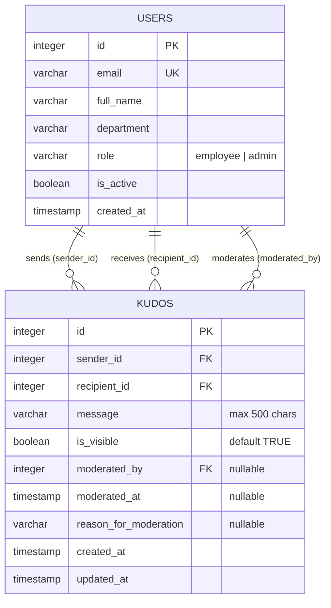

# Kudos System Specification

**Project:** Internal Employee Portal — Peer-to-Peer Kudos System  
**Role:** AI Architect (Datacom Automation AI Accelerator — Task 2)  
**Methodology:** Spec-Driven Development (Specification First → Architect Review & Refinement → Approved Blueprint → Implementation & Verification)

---

## 1. Spec-Driven Workflow Trace

### 1.1 Step 1 — Initial Prompt
> *"Create a feature for our internal web app that allows users to give 'kudos' to their colleagues. A user should be able to select another user from a list, write a short message of appreciation, and submit it. There should also be a public feed on the main dashboard where all recently submitted kudos are visible."*

### 1.2 Step 2 — Architect Review & Refinements Applied Before Approval
The initial prompt produced a baseline peer-to-peer kudos specification, but lacked governance, abuse prevention, and schema auditability. Before approving the specification for implementation, the following architectural refinements were applied:
1. **Added Content Moderation Requirements (US-05):** Introduced an `admin` role capability to **hide** (soft-moderate) or **delete** (hard-remove) inappropriate kudos messages from the public dashboard feed.
2. **Added Edge Cases & Abuse Controls:**
   - Prevent **self-kudos** (`sender_id == recipient_id`).
   - Enforce strict message bounds (**1–500 characters** after trimming whitespace).
   - Detect **duplicate submissions** within a configurable cooldown window (e.g., identical sender, recipient, and normalized message within 5 minutes -> `409 Conflict`).
   - Enforce **per-user rate limiting** against spam bursts (`429 Too Many Requests`).
   - Sanitize/escape HTML payloads to neutralize stored XSS and screen against a configurable inappropriate-term blocklist.
3. **Updated Database Schema (`kudos` table):** Added moderation lifecycle and audit columns:
   - `is_visible` (`BOOLEAN NOT NULL DEFAULT TRUE`)
   - `moderated_by` (`INTEGER / UUID NULL`, FK → `users.id`)
   - `moderated_at` (`TIMESTAMP NULL`)
   - `reason_for_moderation` (`TEXT / VARCHAR(500) NULL`)
   - Added a composite index on `(is_visible, created_at DESC)` so public feed queries remain fast as table volume grows.

---

## 2. Functional Requirements

### 2.1 Authentication & Authorization
- All endpoints and dashboard views require an authenticated internal employee session/identity (`X-User-Id` / session token).
- Two RBAC roles are enforced server-side:
  - `employee`: Can browse active colleagues, submit kudos to colleagues, and view the public feed of visible kudos (`is_visible = TRUE`).
  - `admin`: Inherits all `employee` permissions and can view hidden kudos, hide/restore kudos with an audit reason, or permanently delete kudos.
- Unauthorized requests return `401 Unauthorized`; `employee` users attempting moderation endpoints receive `403 Forbidden`.

### 2.2 User Stories
1. **US-01 (Colleague Selection):** As an authenticated employee, I want to select a colleague from an alphabetical list of active employees (excluding myself), so I know accurately who will receive my appreciation.
2. **US-02 (Message Composition):** As an authenticated employee, I want to write a short appreciation message (up to 500 characters) with live character count feedback and validation, so my recognition is clear and concise.
3. **US-03 (Kudos Submission & Persistence):** As an authenticated employee, I want to submit my kudos and have it validated, sanitized, and persisted in the database, so it appears immediately in the dashboard feed.
4. **US-04 (Public Dashboard Feed):** As an authenticated employee, I want to view a reverse-chronological, paginated public feed of recently submitted visible kudos on the main dashboard, so the entire organization can celebrate peer achievements.
5. **US-05 (Content Moderation):** As an administrator, I want to hide (with a recorded moderation reason and audit trail) or permanently delete inappropriate or spam kudos messages, so the public feed remains safe and professional.

### 2.3 Detailed Acceptance Criteria

#### US-01: Select a Colleague
- **Given** an authenticated user opens the "Give Kudos" form,
- **When** the colleague dropdown loads via `GET /api/users`,
- **Then** all active colleagues except the current user are listed with display name and department/role, sorted alphabetically by name.
- **And** if the user attempts to submit kudos targeting their own `user_id` via API, the server rejects the request with `400 Bad Request` (`"Cannot send kudos to yourself"`).

#### US-02: Write Appreciation Message
- **Given** a colleague is selected,
- **When** the user types a message in the textarea,
- **Then** a live counter displays remaining/current characters out of `500`.
- **When** the trimmed message is empty (`0` chars) or exceeds `500` chars,
- **Then** submission is prevented client-side and rejected server-side with `400 Bad Request`.

#### US-03: Submit Kudos (Edge Cases & Validation)
- **Given** valid `recipient_id` and `message`,
- **When** `POST /api/kudos` is called:
  - If `recipient_id` does not exist or is inactive -> `404 Not Found` / `400 Bad Request`.
  - If the message contains blocked/inappropriate language -> `400 Bad Request` (`"Message violates workplace content policy"`).
  - If an identical `(sender_id, recipient_id, normalized_message)` kudos was submitted within the last 5 minutes -> `409 Conflict` (`"Duplicate kudos detected"`).
  - If the sender exceeds the burst limit (e.g., >10 kudos within 60 seconds) -> `429 Too Many Requests`.
  - Otherwise -> stores HTML-escaped/sanitized text with `is_visible = TRUE`, returns `201 Created`, and prepends the entry to the feed.

#### US-04: Public Dashboard Feed
- **Given** the main dashboard loads,
- **When** `GET /api/kudos?limit=20&offset=0` is called by an `employee`,
- **Then** only records with `is_visible = TRUE` are returned, ordered by `created_at DESC, id DESC`, including sender name, recipient name, message, and timestamp.
- **When** `include_hidden=true` is requested by an `admin`,
- **Then** both visible and hidden kudos (with moderation metadata) are returned for review.

#### US-05: Administrator Content Moderation
- **Given** an authenticated `admin` reviews a kudos entry:
  - **Hide (`PATCH /api/kudos/{id}/moderate`):** With `{ "action": "hide", "reason": "..." }` (non-empty reason required), sets `is_visible = FALSE`, `moderated_by = admin.id`, `moderated_at = UTC_NOW`, `reason_for_moderation = reason`. The item disappears immediately from public feeds while preserving the audit record.
  - **Restore (`PATCH /api/kudos/{id}/moderate`):** With `{ "action": "restore", "reason": "..." }`, sets `is_visible = TRUE`, updates `moderated_by`, `moderated_at`, and `reason_for_moderation`.
  - **Delete (`DELETE /api/kudos/{id}`):** Permanently removes the record from `kudos` and emits an immutable audit log entry; subsequent lookups return `404 Not Found`.
- **Given** a non-admin (`employee`) calls `PATCH /api/kudos/{id}/moderate` or `DELETE /api/kudos/{id}`,
- **Then** the server denies access with `403 Forbidden`.

### 2.4 Responsive Design & Accessibility
- **Breakpoints:**
  - Desktop (`>= 1024px`): Two-column dashboard grid (Give Kudos form sidebar + Public Feed main panel).
  - Tablet (`768px–1023px`) & Mobile (`< 768px`): Single-column stacked layout with full-width controls and >= 44px touch targets.
- **Accessibility:** Semantic HTML landmarks, explicit `<label>` bindings, `aria-live="polite"` status/error announcements, and keyboard-accessible moderation actions.

---

## 3. Technical Design

### 3.1 Database Schema



#### SQL DDL (SQLite / PostgreSQL Compatible)
```sql
CREATE TABLE IF NOT EXISTS users (
    id INTEGER PRIMARY KEY AUTOINCREMENT,
    email TEXT NOT NULL UNIQUE,
    full_name TEXT NOT NULL,
    department TEXT NOT NULL DEFAULT 'General',
    role TEXT NOT NULL DEFAULT 'employee' CHECK (role IN ('employee', 'admin')),
    is_active INTEGER NOT NULL DEFAULT 1 CHECK (is_active IN (0, 1)),
    created_at TEXT NOT NULL DEFAULT (strftime('%Y-%m-%dT%H:%M:%fZ', 'now'))
);

CREATE TABLE IF NOT EXISTS kudos (
    id INTEGER PRIMARY KEY AUTOINCREMENT,
    sender_id INTEGER NOT NULL REFERENCES users(id) ON DELETE CASCADE,
    recipient_id INTEGER NOT NULL REFERENCES users(id) ON DELETE CASCADE,
    message TEXT NOT NULL CHECK (length(trim(message)) BETWEEN 1 AND 500),
    is_visible INTEGER NOT NULL DEFAULT 1 CHECK (is_visible IN (0, 1)),
    moderated_by INTEGER NULL REFERENCES users(id) ON DELETE SET NULL,
    moderated_at TEXT NULL,
    reason_for_moderation TEXT NULL,
    created_at TEXT NOT NULL DEFAULT (strftime('%Y-%m-%dT%H:%M:%fZ', 'now')),
    updated_at TEXT NOT NULL DEFAULT (strftime('%Y-%m-%dT%H:%M:%fZ', 'now')),
    CHECK (sender_id <> recipient_id)
);

CREATE INDEX IF NOT EXISTS idx_kudos_public_feed
    ON kudos (is_visible, created_at DESC, id DESC);

CREATE INDEX IF NOT EXISTS idx_kudos_duplicate_check
    ON kudos (sender_id, recipient_id, created_at DESC);
```

### 3.2 API Endpoints Specification

All endpoints expect authenticated context (`X-User-Id` header in standalone dev mode / validated session cookie or JWT in production) and return `application/json`.

| Method | Endpoint | Auth Role | Purpose | Status Codes |
| :--- | :--- | :--- | :--- | :--- |
| `GET` | `/api/users` | `employee`, `admin` | List active colleagues (excludes current user by default unless `?include_self=true`) | `200`, `401` |
| `GET` | `/api/kudos` | `employee`, `admin` | Paginated public feed (`?limit=20&offset=0`); `?include_hidden=true` allowed for `admin` only | `200`, `401`, `403` |
| `POST` | `/api/kudos` | `employee`, `admin` | Create & persist a new kudos entry | `201`, `400`, `401`, `404`, `409`, `429` |
| `PATCH` | `/api/kudos/{id}/moderate` | `admin` | Hide (`is_visible=false`) or restore (`is_visible=true`) a kudos with audit reason | `200`, `400`, `401`, `403`, `404` |
| `DELETE` | `/api/kudos/{id}` | `admin` | Permanently delete a kudos entry | `200`, `401`, `403`, `404` |

#### Example Request & Response Payloads
- **`POST /api/kudos`**
  ```json
  // Request
  { "recipient_id": 2, "message": "Thank you for helping onboard the client smoothly!" }

  // Response (201 Created)
  {
    "kudos": {
      "id": 14,
      "sender_id": 1,
      "sender_name": "Alice Silva",
      "recipient_id": 2,
      "recipient_name": "Bob Santos",
      "message": "Thank you for helping onboard the client smoothly!",
      "is_visible": true,
      "moderated_by": null,
      "moderated_at": null,
      "reason_for_moderation": null,
      "created_at": "2026-11-15T20:30:00.000000Z"
    }
  }
  ```
- **`PATCH /api/kudos/14/moderate`**
  ```json
  // Request
  { "action": "hide", "reason": "Contains off-topic solicitation link" }

  // Response (200 OK)
  {
    "kudos": {
      "id": 14,
      "is_visible": false,
      "moderated_by": 99,
      "moderated_at": "2026-11-15T20:32:10.000000Z",
      "reason_for_moderation": "Contains off-topic solicitation link"
    }
  }
  ```

### 3.3 Frontend Component Hierarchy

```text
AppShell
 ├── TopNavBar (Current User / Role Switcher in demo, Refresh trigger)
 └── KudosDashboard (Responsive 2-col desktop / 1-col mobile grid)
      ├── KudosSubmissionCard
      │    ├── ColleagueSelect (Dropdown populated from GET /api/users)
      │    ├── MessageComposer (Textarea + 0/500 live character counter)
      │    └── SubmitStatusBanner (Inline validation / success / duplicate errors)
      └── KudosPublicFeed
           ├── FeedHeader (Count badge + Admin "Show Hidden Kudos" toggle)
           ├── KudosCard[] (Sender -> Recipient, timestamp, sanitized message, hidden badge)
           │    └── AdminModerationBar (visible only for admin: Hide/Restore button + Delete button)
           ├── PaginationControls ("Load More" / Next / Previous)
           └── ModerationReasonModal (Prompts admin for required reason before hiding/restoring)
```

### 3.4 Security, Performance, and Error Handling Strategies
- **Security:**
  - Server-side RBAC enforcement on every protected endpoint (never trust client-side role visibility alone).
  - Parameterized SQL queries (`?` placeholders) prevent SQL injection.
  - HTML entity escaping (`html.escape`) on stored/rendered message inputs + DOM `textContent` rendering prevents XSS.
  - Anti-spam rate limiting (`MAX_KUDOS_PER_MINUTE = 10`) and duplicate cooldown (`DUPLICATE_WINDOW_SECONDS = 300`).
- **Performance:**
  - Composite index `idx_kudos_public_feed (is_visible, created_at DESC, id DESC)` ensures `O(log N + limit)` feed reads without full-table scans.
  - Bounded pagination (`limit` capped at `50`) avoids excessive payload sizes.
- **Error Handling & Logging:**
  - Consistent JSON error schema: `{ "error": { "code": "...", "message": "..." } }`.
  - Structured application logs capture validation rejections, rate-limit events, and immutable moderation audit records (`who`, `action`, `target_kudos_id`, `reason`, `timestamp`).

---

## 4. Implementation Plan

| Task ID | Phase | Description | Depends On |
| :--- | :--- | :--- | :--- |
| **T1** | Database | Create SQLite/SQL schema (`users`, `kudos`, moderation columns, constraints, and indexes) + seed helper | — |
| **T2** | Domain & Validation | Implement message sanitization, length checks, self-kudos check, profanity filter, duplicate detection, and rate limiting | T1 |
| **T3** | Services & RBAC | Implement `KudosService` methods (`list_colleagues`, `create_kudos`, `get_public_feed`, `moderate_kudos`, `delete_kudos`) with strict admin authorization | T1, T2 |
| **T4** | HTTP API & Static UI | Build `http.server` / WSGI REST endpoints and serve responsive `index.html` dashboard | T3 |
| **T5** | Frontend Components | Implement `ColleagueSelect`, 500-char counter, feed rendering, pagination, and `AdminModerationModal` | T4 |
| **T6** | Verification | Write `test_kudos.py` covering all 5 user stories, schema fields, moderation audit trail, RBAC, and HTTP API end-to-end | T3, T4 |

### Testing & Deployment Strategy
- **Testing:** Automated `unittest` suite (`test_kudos.py`) exercising repository, service validation/edge cases, moderation audit persistence, and live HTTP API calls against an isolated temporary SQLite database.
- **Deployment Considerations:** Externalize `DATABASE_PATH`, `DUPLICATE_WINDOW_SECONDS`, and `RATE_LIMIT_PER_MINUTE` via environment variables; place behind an SSO/OIDC reverse proxy in production so `X-User-Id` is replaced by verified enterprise identity tokens; run automated schema migrations before startup.

---

## 5. Reflection Questions (Architect Notes)

1. **How did the structured approach to specification change the development process compared to traditional "vibe coding"?**  
   Writing the blueprint first exposed missing business constraints—most importantly content moderation, auditability (`moderated_by`, `moderated_at`, `reason_for_moderation`), self-kudos checks, and duplicate cooldowns—*before* a single line of application code or SQL was written, preventing costly mid-implementation rewrites.
2. **What was the most challenging part of reviewing and refining the AI-generated specification?**  
   Thinking adversarially about edge cases that the initial prompt omitted: distinguishing soft hiding (`is_visible = FALSE` with an audit trail) from hard deletion, ensuring RBAC cannot be bypassed via direct API parameters like `?include_hidden=true`, and balancing spam protection with legitimate usage.
3. **How did having a complete specification before implementation affect the quality and completeness of the final code?**  
   With explicit SQL constraints, HTTP status codes, and acceptance criteria locked in upfront, both `kudos_app.py` and `test_kudos.py` aligned cleanly on the first pass—every edge case in `SPECIFICATION.md` mapped 1-to-1 to a server guard and an automated unit test.
