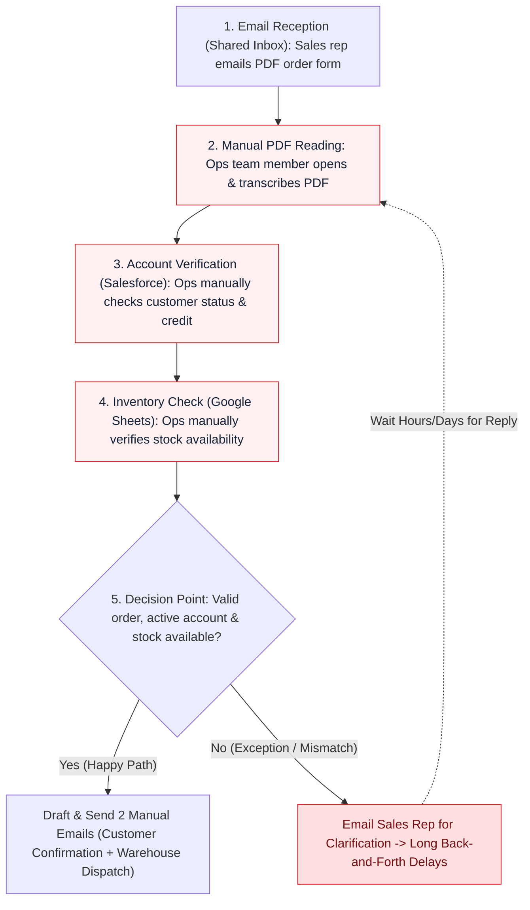
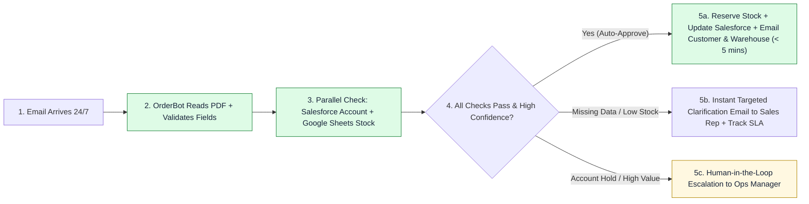

# Task 3: Strategic Automation Proposal — OrderBot (Autonomous Hardware Order Agent)

**Simulation:** Datacom — *Automation AI Accelerator: From Co-pilot to Autonomous Agent*  
**Role:** Strategic Technology Partner / AI Architect  
**Audience:** Head of Operations & Executive Leadership  
**Deliverables:** [`OrderBot_Presentation.pdf`](./OrderBot_Presentation.pdf), [`OrderBot_Presentation.pptx`](./OrderBot_Presentation.pptx), [`presentation.html`](./presentation.html), and this design brief (`ORDERBOT_PROPOSAL.md`)

---

## Step 1: Current Process Analysis & Workflow Mapping

### 1.1 As-Is Manual Hardware Order Workflow

### 1.2 Step-by-Step Bottleneck & Failure Analysis

| Step | System(s) | Typical Active Effort + Queue Delay | Failure Points & Operational Pain |
| :--- | :--- | :--- | :--- |
| **1. Email Reception** | Shared Email Inbox | Immediate arrival, **1–6 hrs** sitting unread in inbox | No automatic triage; orders buried behind non-order threads; zero processing outside business hours. |
| **2. Manual PDF Reading** | PDF Viewer | **5–10 mins** active reading/typing | Manual transcription errors (~5–8% typo rate on SKUs, quantities, or shipping addresses); non-standard PDF layouts slow down staff. |
| **3. Account Verification** | Salesforce CRM | **5–10 mins** context switching | Risk of missing account holds, expired contracts, or overdue invoices when rushed during peak hours. |
| **4. Inventory Check** | Google Sheets | **5–10 mins** manual lookup | Stale spreadsheet views during concurrent orders; risk of overselling last units in stock; no automatic reservation. |
| **5. Decision & Emails** | Shared Email Inbox | **5–15 mins** drafting (+ **4–24 hrs** if exception occurs) | Forgetting to notify warehouse or customer; long silent stalls when waiting on sales reps; **complete standstill when ops staff are sick, on leave, or after-hours**. |

**Baseline Capacity & SLA Summary (Estimated Operations Profile):**
- **Daily Volume:** ~40–60 orders/day (~200–300 orders/week), spiking at month-end.
- **End-to-End Turnaround Time:** **4 to 24+ hours** per order (15–45 minutes active ops labor + inbox/exception queue time).
- **Primary Constraint:** Human attention spent on repetitive "swivel-chair" data transfer across three disconnected tools (Email ↔ Salesforce ↔ Google Sheets).

---

## Step 2: Conceptual Agentic AI Design — `OrderBot`

`OrderBot` is designed around the four core principles of an agentic AI system:
1. **Autonomy:** Monitors the shared inbox 24/7 and executes end-to-end validation and routing without manual triggers.
2. **Goal-Focus:** Optimized for a single measurable SLA—accurate order confirmation within 5 minutes.
3. **Adaptability:** Dynamically selects between a **Fast-Track Fulfillment Plan** and an **Exception Resolution Plan** based on live Salesforce and inventory state.
4. **Learning Capability:** Logs outcomes and exception patterns over time to improve form validation and flag repeat bottlenecks.

### 2.1 Anatomy of a Business Process Agent (`OrderBot`)

| Component | Description | Application to `OrderBot` |
| :--- | :--- | :--- |
| **Goal** | Primary, measurable business objective the agent optimizes for. | Autonomously process incoming hardware orders from email receipt to customer/warehouse confirmation **within 5 minutes**, achieving **>= 99.5% validation accuracy**. |
| **Perception (Tools)** | Read-only integrations enabling `OrderBot` to observe its environment. | • **Email Reader API:** Monitors shared inbox for order attachments and replies. • **Intelligent PDF Parser (OCR + Schema Extractor):** Extracts customer ID, SKUs, quantities, shipping address, and confidence scores. • **Salesforce API (Read):** Queries account standing, credit limit, and contract status. • **Google Sheets API (Read):** Reads live SKU stock levels and reorder thresholds. |
| **Planning** | Internal reasoning loop breaking the goal into dynamic steps. | 1. Detect new email with PDF attachment. 2. Extract structured order JSON + field confidence scores. 3. Verify customer standing in Salesforce. 4. Verify stock availability in Google Sheets. 5. **Evaluate Decision Rules:** Select **Success Plan**, **Clarification Plan**, or **Human Escalation Plan**. 6. Execute actions and log full audit trail. |
| **Action (Tools)** | Write/notify integrations enabling `OrderBot` to act safely. | • **Email Sender API:** Sends branded confirmation to customer + structured dispatch ticket to warehouse (or targeted clarification prompt to sales rep). • **Salesforce API (Write):** Logs order record & audit note on customer timeline. • **Google Sheets API (Write):** Atomically reserves/decrements inventory count. • **Ops Escalation Alert (Slack/Teams/Email):** Flags high-value or low-confidence anomalies for human sign-off. |
| **Memory / Learning** | Persistent outcome tracking to continuously improve accuracy. | Logs every decision, extraction confidence, and exception reason. Identifies recurring patterns (e.g., specific sales reps submitting outdated PDF templates or specific SKUs frequently hitting low stock) and surfaces weekly continuous-improvement insights. |

### 2.2 Decision-Making & Exception-Handling Matrix

| Scenario | Condition Detected | `OrderBot` Action & Safeguard |
| :--- | :--- | :--- |
| **Clean Order (Success)** | PDF confidence >= 98%, Salesforce account active & within credit, stock >= requested qty | Atomically decrement Google Sheets inventory, create Salesforce order entry, email customer + warehouse within 5 mins. |
| **Incomplete / Unreadable PDF** | Missing required field (e.g., SKU/address) or OCR confidence < 95% | Do **not** guess; reply immediately to sales rep listing the exact missing fields and log pending status. |
| **Account Hold / Credit Risk** | Salesforce status = Hold/Suspended or order exceeds threshold (e.g., > \$25,000) | Pause automated fulfillment and route immediately to Ops/Finance for **Human-in-the-Loop approval**. |
| **Insufficient Stock** | Requested qty > available Google Sheets stock | Notify sales rep and warehouse of exact shortfall + current lead time; optionally propose partial shipment. |
| **System / API Outage** | Salesforce or Google Sheets API times out after retries | Exponential backoff retry (3x); if still unreachable, move order to safe dead-letter queue and alert Ops—**zero lost orders**. |

### 2.3 Automated To-Be Workflow

---

## Step 3: 3-Slide Executive Presentation Blueprint

### Slide 1: The Problem — Our Current Order Process Is a Bottleneck
- **Headline:** Manual hardware order processing creates multi-hour delays, transcription errors, and single points of failure.
- **Visual:** Clean 5-step As-Is flowchart highlighting **Email → PDF → Salesforce → Google Sheets → Decision** with **red callouts** on manual handoffs and exception loops.
- **Key Pain Points & Baseline Metrics:**
  - **4–24+ hr turnaround:** Orders sit in a shared inbox before manual review and stall for days on exceptions.
  - **5–8% manual error rate:** Re-keying PDF details across Salesforce and Google Sheets causes wrong SKUs and mis-shipments.
  - **Zero 24/7 coverage:** Processing stops completely outside business hours or when ops staff are away.
  - **High-skill staff trapped in low-value work:** ~15–45 mins per order spent on copy-paste coordination.

### Slide 2: The Solution — Introducing `OrderBot`, Our Autonomous AI Agent
- **Headline:** `OrderBot` transforms a 5-step manual bottleneck into an intelligent, 24/7 autonomous workflow under 5 minutes.
- **Visual:** Streamlined green To-Be flowchart paired with a clean 4-pillar summary of `OrderBot` (**Goal**, **Perception**, **Planning & Decisions**, **Action & Learning**).
- **Business-Friendly Narrative:**
  - **Reads & Understands:** Automatically picks up PDF orders from the shared inbox and extracts key order details.
  - **Verifies in Real Time:** Checks customer standing in Salesforce and live stock in Google Sheets instantly.
  - **Acts with Guardrails:** Sends customer and warehouse confirmations automatically on clean orders; immediately escalates edge cases (credit holds, low stock, unclear PDFs) to the right person.
  - **Learns Over Time:** Tracks recurring bottlenecks (e.g., incomplete rep submissions) so operations keep getting smarter.

### Slide 3: Business Impact & Recommended Next Steps
- **Headline:** Delivering faster fulfillment, zero transcription errors, and a low-risk path to production.
- **Tangible Business Impact:**
  - **Turnaround Speed:** **4–24+ hours → under 5 minutes** (24/7/365 coverage).
  - **Accuracy:** Target **>= 99.5%** extraction & validation accuracy (eliminating copy-paste errors).
  - **Team Capacity:** Reclaims **~85% of routine ops effort** so staff focus on strategic supplier management and VIP exceptions.
  - **Customer Experience:** Instant order confirmation builds client trust and accelerates warehouse dispatch.
- **Recommended Low-Risk Next Step (3-Phase Rollout):**
  1. **Phase 1 — Read-Only Shadow Mode PoC (Weeks 1–2):** `OrderBot` reads live incoming PDFs, queries Salesforce & Google Sheets, and **drafts** decisions/emails for Ops review *without sending emails or modifying stock*. Target exit gate: **>= 99% agreement** with human ops over 100 real orders.
  2. **Phase 2 — Human-Approved Co-Pilot (Weeks 3–4):** One-click Ops approval before dispatching emails and decrementing inventory.
  3. **Phase 3 — Full Autonomous Mode with Guardrails (Week 5+):** End-to-end auto-execution for standard orders, keeping human escalation mandatory for credit holds, low-confidence PDFs, and high-value orders.

---

## Reflection Questions

1. **What are the biggest risks or potential failure points in the agentic solution you designed?**
   - *Data extraction errors* on poorly formatted or scanned PDFs leading to wrong quantities/SKUs; *race conditions* in Google Sheets when two orders claim the last unit simultaneously; *silent API failures* with Salesforce/Sheets; and *over-trusting AI autonomy* on high-financial-impact or credit-risk orders. These are mitigated via confidence thresholds (< 95% triggers human review), atomic inventory locking/validation, retry queues, and starting with a read-only shadow PoC.
2. **In this fully automated workflow, where is human oversight still absolutely critical, and why?**
   - Human judgment remains essential for: (a) **Credit/account exceptions and high-value thresholds** where commercial relationships and financial risk outweigh speed; (b) **Ambiguous or low-confidence PDF parsing** so the agent never guesses an order; (c) **Final sign-off during the Shadow PoC & Co-Pilot rollout phases**; and (d) **Periodic review of Memory/Learning insights** to fix root causes upstream with sales reps.
3. **How has this programme's progression—from AI-assisted coding to architecting autonomous systems—changed your view of a software developer's role and responsibilities?**
   - Across Task 1 (*Pilot*), Task 2 (*Architect*), and Task 3 (*Strategic Technology Partner*), the developer's highest leverage shifts away from typing boilerplate toward **framing problems clearly, defining testable specifications, designing safe tool boundaries/guardrails, verifying outputs empirically, and translating technical AI capabilities into measurable business outcomes**.
